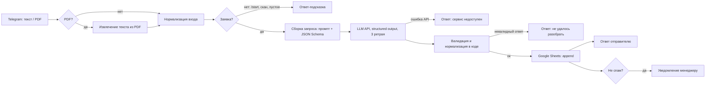

# Lead Intake Bot: Telegram → LLM → Google Sheets

Telegram-бот на **n8n**, который разбирает входящие заявки клиентов. Принимает текст или PDF, извлекает структурированные данные через LLM (**structured output по JSON Schema**), валидирует их кодом, записывает строку в **Google Таблицу**, отвечает отправителю и уведомляет менеджера.

<!-- Добавьте скриншоты после запуска: docs/screenshots/workflow.png, chat.png, sheet.png -->
| Workflow в n8n | Диалог с ботом | Таблица заявок |
|---|---|---|
|  |  |  |

## Что решает

Менеджер вручную читает заявки из мессенджеров и писем, вытаскивает контакты, суть, бюджет и сроки и переносит их в таблицу или CRM. Бот делает это автоматически: заявка попадает в таблицу в едином формате через несколько секунд, а сомнительные случаи помечаются для ручной проверки.

## Как работает



Каждая заявка получает статус:

| Статус | Когда |
|---|---|
| `new` | есть валидный телефон или email, уверенность модели ≥ 0.6 |
| `needs_review` | нет контактов, контакт не прошёл валидацию или низкая уверенность |
| `spam` | модель определила, что это не обращение клиента; менеджер не уведомляется |

## Что учтено

- **Structured output со строгой схемой** (`strict: true`): модель не может вернуть произвольный JSON. Ответ всё равно проверяется в коде, потому что OpenAI-совместимые провайдеры соблюдают схему по-разному.
- **Модель не нормализует данные.** Телефоны, email, даты и enum приводятся к формату в коде: это детерминированно и покрыто тестами.
- **Защита от prompt injection.** Текст заявки передаётся между маркерами `<<< >>>`, а промпт явно запрещает выполнять инструкции из него (пример: `samples/04-prompt-injection.txt`).
- **Относительные сроки** («через две недели», «до конца месяца») пересчитываются в дату: модель получает текущую дату в часовом поясе Asia/Almaty.
- **Сбои:** ретраи HTTP-запроса к LLM, отдельные ветки для недоступного API и невалидного ответа модели, понятные ответы пользователю вместо тишины.
- **PDF-сканы без текстового слоя** определяются и получают отдельное сообщение.
- **Экранирование HTML** в ответах Telegram: данные клиента не ломают разметку.

## Стек

n8n · OpenAI API (или OpenRouter) · Telegram Bot API · Google Sheets API · Node.js (тесты на `node:test`, без зависимостей) · Docker

## Структура

```
src/
  normalize-input.js     # Telegram-сообщение → единый формат, определение типа входа
  build-request.js       # запрос к LLM: промпт, JSON Schema, дата, обрезка длинного текста
  process-response.js    # разбор ответа LLM, валидация, нормализация, статус, тексты ответов
prompts/extract-lead.system.md   # системный промпт
schema/lead.schema.json          # JSON Schema для structured output
scripts/build-workflow.mjs       # собирает workflow n8n из src/, промпта и схемы
workflow/lead-intake.workflow.json   # готовый для импорта workflow
tests/                           # unit-тесты логики
samples/                         # примеры заявок (текст и PDF) и заголовок таблицы
```

**Почему логика в `src/`, а не только в Code-нодах n8n.** Код внутри n8n плохо тестировать и сложно ревьюить в git. Здесь вся логика живёт в обычных JS-файлах с тестами, а `npm run build` встраивает её в Code-ноды. Промпт и схема тоже хранятся отдельно, и их изменения видны в diff.

## Запуск

### 1. Подготовка

1. **Бот:** создайте его через [@BotFather](https://t.me/BotFather) и сохраните токен.
2. **Таблица:** создайте Google Таблицу с листом `Leads` и вставьте в первую строку заголовки из `samples/sheet-header.csv`. ID таблицы находится в URL: `docs.google.com/spreadsheets/d/<ID>/edit`.
3. **Chat ID менеджера:** напишите что-нибудь [@userinfobot](https://t.me/userinfobot). Для группы добавьте бота в группу; её ID начинается с `-100`.
4. **Ключ LLM:** понадобится ключ OpenAI или OpenRouter.

### 2. Публичный адрес для webhook

Telegram отправляет обновления только на HTTPS. Для локального запуска подойдёт бесплатный туннель:

```bash
cloudflared tunnel --url http://localhost:5678
# скопируйте выданный адрес https://xxxx.trycloudflare.com
```

### 3. n8n

```bash
cp .env.example .env      # заполните WEBHOOK_URL, N8N_HOST, N8N_ENCRYPTION_KEY, SPREADSHEET_ID, MANAGER_CHAT_ID
npm run build             # подставит ID таблицы, чат менеджера и модель в workflow
docker compose up -d
```

Откройте `http://localhost:5678` и создайте аккаунт.

### 4. Импорт и credentials

1. **Импорт:** Workflows → Import from File → `workflow/lead-intake.workflow.json`.
2. **Credentials в нодах:**
   - **Telegram API:** токен бота. Используется в `Telegram Trigger` и во всех нодах отправки.
   - **Header Auth** (нода `LLM: extract fields`): Name = `Authorization`, Value = `Bearer <ключ API>`.
   - **Google Sheets OAuth2:** авторизация Google-аккаунта.
3. **Лист таблицы:** в ноде `Append to Google Sheet` выберите лист `Leads`.
4. **Запуск:** активируйте workflow и отправьте боту текст из `samples/` или файл `samples/05-request-letter.pdf`.

### OpenRouter вместо OpenAI

Укажите в `.env` эти значения и пересоберите workflow:

```
LLM_URL=https://openrouter.ai/api/v1/chat/completions
LLM_MODEL=openai/gpt-4o-mini
```

Выбирайте модель, которая поддерживает `response_format: json_schema`.

## Разработка

```bash
npm test         # unit-тесты логики
npm run build    # пересобрать workflow после изменений в src/, prompts/ или schema/
npm run check    # тесты + сборка
```

**Добавить поле в заявку:**
1. Добавьте его в `schema/lead.schema.json`.
2. Добавьте колонку в `SHEET_COLUMNS` (`src/process-response.js`) и в таблицу.
3. Обновите тесты.
4. Выполните `npm run build` и повторно импортируйте workflow.

## Возможные улучшения

- Дедупликация повторных заявок от одного контакта (по телефону/email за N часов).
- Отправка в CRM (amoCRM / Bitrix24) вместо или вместе с таблицей.
- OCR для PDF-сканов и фото.
- Регрессионный прогон промпта на наборе размеченных заявок (eval) перед изменением промпта или модели.
